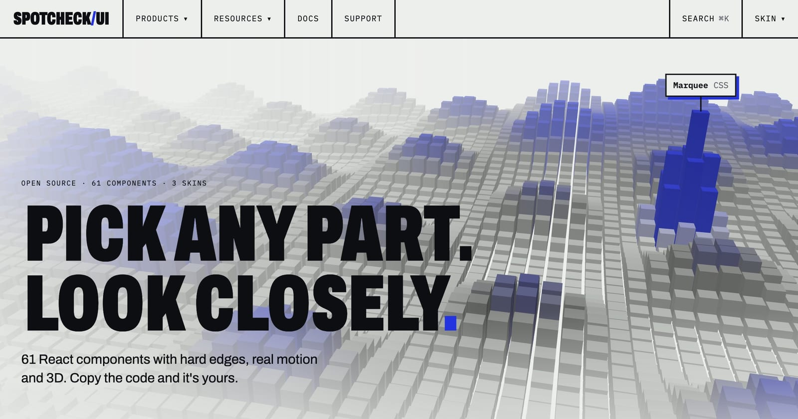
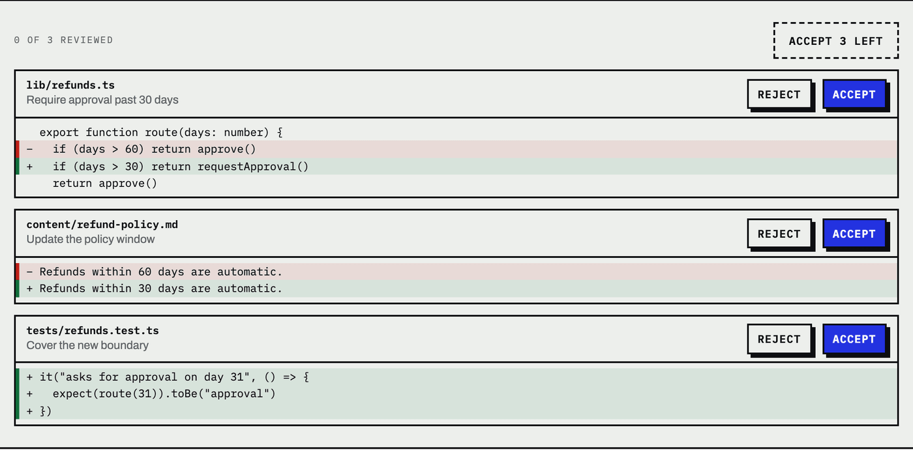
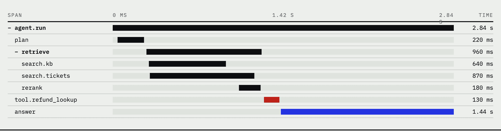
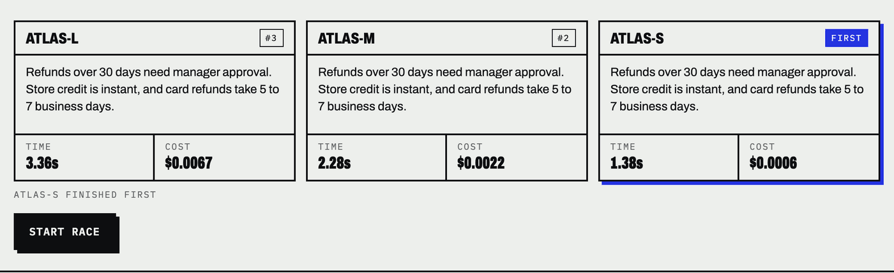
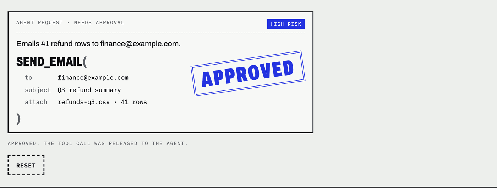
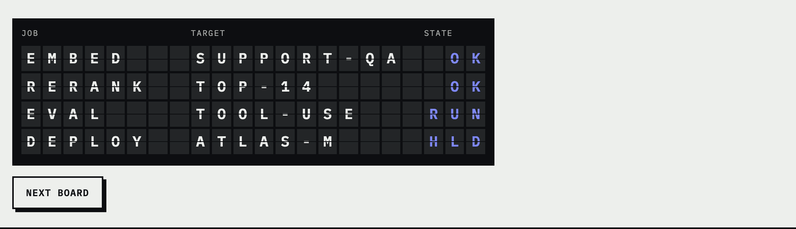
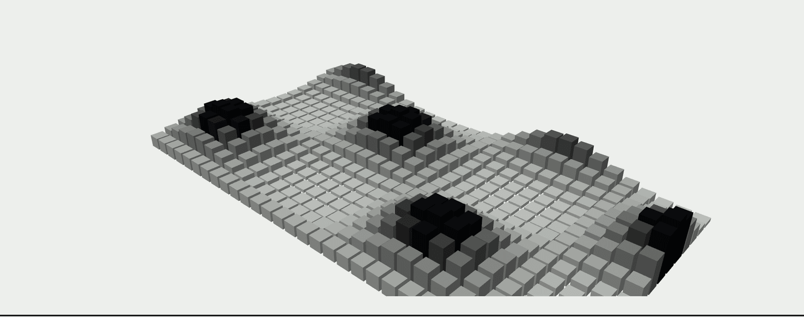

<a href="https://spotcheckui.com">
  
</a>

# Spotcheck UI

Open source React components for checking what AI did: diffs you accept hunk by hunk, a trace
waterfall, a model race and a sign-off stamp. Hard edges, real motion and some 3D.

[](LICENSE)
[](https://spotcheckui.com/docs/installation)
[](https://react.dev)
[](https://tailwindcss.com)

**[See every component live](https://spotcheckui.com/components)** ·
[Docs](https://spotcheckui.com/docs/installation) ·
[Field notes](https://spotcheckui.com/field-notes) ·
[YouTube](https://www.youtube.com/@spotcheckui) ·
[Instagram](https://www.instagram.com/spotcheckui/)

## Install

There's no npm package. Each component installs through the shadcn CLI, which copies its source into
your project, so the code is yours to read and change.

```bash
npx shadcn@latest add https://spotcheckui.com/r/diff-review.json
```

You need React 19, Tailwind CSS v4 and a project set up with `npx shadcn@latest init`. The first
install adds the Spotcheck tokens and fonts and leaves your existing theme alone. The
[installation guide](https://spotcheckui.com/docs/installation) has the details, and
[theming](https://spotcheckui.com/docs/theming) covers dark mode and the three skins.

## Built for checking AI work

### [Diff Review](https://spotcheckui.com/components/diff-review)

Accept or reject an agent's edits hunk by hunk, with undo.

<picture>
  <source media="(prefers-color-scheme: dark)" srcset=".github/readme/diff-review-dark.png">
  
</picture>

```bash
npx shadcn@latest add https://spotcheckui.com/r/diff-review.json
```

### [Trace Waterfall](https://spotcheckui.com/components/trace-waterfall)

Nested spans on a shared timeline, so parallel work and slow steps show up at a glance.

<picture>
  <source media="(prefers-color-scheme: dark)" srcset=".github/readme/trace-waterfall-dark.png">
  
</picture>

```bash
npx shadcn@latest add https://spotcheckui.com/r/trace-waterfall.json
```

### [Model Race](https://spotcheckui.com/components/model-race)

One prompt across several models, with live time and cost, and the winner marked.

<picture>
  <source media="(prefers-color-scheme: dark)" srcset=".github/readme/model-race-dark.png">
  
</picture>

```bash
npx shadcn@latest add https://spotcheckui.com/r/model-race.json
```

### [Stamp Approval](https://spotcheckui.com/components/stamp-approval)

Human sign-off for an agent's tool call. The decision lands as a rubber stamp.

<picture>
  <source media="(prefers-color-scheme: dark)" srcset=".github/readme/stamp-approval-dark.png">
  
</picture>

```bash
npx shadcn@latest add https://spotcheckui.com/r/stamp-approval.json
```

## Motion and 3D

<table>
  <tr>
    <td width="50%">
      <a href="https://spotcheckui.com/components/split-flap"><b>Split-Flap Board</b></a><br>
      A departures board for jobs. Each changed cell spins through glyphs.<br><br>
      <picture>
        <source media="(prefers-color-scheme: dark)" srcset=".github/readme/split-flap-dark.png">
        
      </picture>
    </td>
    <td width="50%">
      <a href="https://spotcheckui.com/components/bar-terrain"><b>Bar Terrain</b></a><br>
      An instanced WebGL field of bars, with a bump under the pointer.<br><br>
      <picture>
        <source media="(prefers-color-scheme: dark)" srcset=".github/readme/bar-terrain-dark.png">
        
      </picture>
    </td>
  </tr>
</table>

Screenshots don't show the motion. The [site](https://spotcheckui.com/components) does, and so do the
short demos on [YouTube](https://www.youtube.com/@spotcheckui).

## All 61 components

| Group | Count | What they're for |
|---|---|---|
| [AI](https://spotcheckui.com/components#ai) | 10 | Reviewing, grading and auditing model output |
| [Screens](https://spotcheckui.com/components#screens) | 3 | Larger blocks assembled from the other parts |
| [WebGL](https://spotcheckui.com/components#webgl) | 2 | Instanced bar fields and an embedding space |
| [Depth](https://spotcheckui.com/components#depth) | 6 | 3D built into everyday components |
| [Springs](https://spotcheckui.com/components#springs) | 3 | Physics on sliders, stamps and other controls |
| [Timelines](https://spotcheckui.com/components#timelines) | 4 | Split-flap boards, grid ripples and lines that draw themselves |
| [Motion](https://spotcheckui.com/components#motion) | 5 | Numbers that roll, headings that decode, lists that file in |
| [Core](https://spotcheckui.com/components#core) | 28 | Primitives cut from a ruled grid |

## Found a bug or have an idea?

[Open an issue](https://github.com/Surya96t/spotcheck-ui/issues) for bugs, especially on phones and
Safari. Questions and ideas go in [Discussions](https://github.com/Surya96t/spotcheck-ui/discussions).

## Working on the site

```bash
pnpm install
pnpm dev
```

The site runs at `http://localhost:3000`. Components live in `registry/spotcheck/`, and their docs
pages in `content/components/`. These checks run in CI:

```bash
pnpm lint
pnpm typecheck
pnpm test
pnpm build
pnpm test:e2e
pnpm test:install
```

`test:install` builds a fresh Next.js app, installs 25 of the components through the shadcn CLI,
and checks that they build and run.

## Licence

[MIT](LICENSE). Fonts and other open source parts are listed in [CREDITS.md](CREDITS.md).
